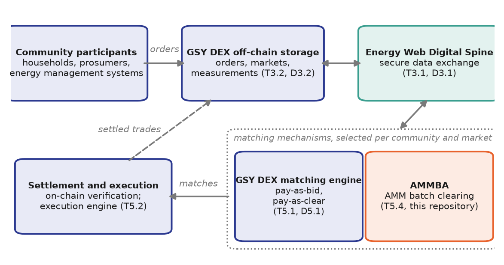

# AMMBA: Automated Market Maker for Batch Auctions

[](https://github.com/INTELLIGENT-UoC/ammba_uoc/actions/workflows/ci.yml)
[](LICENSE)

**An AMM-based trading mechanism for local energy communities.**

AMMBA clears local energy markets in periodic batches. Participants submit the
quantities they want to buy or sell for a delivery slot. When the slot closes,
all orders are cleared together against a community pool at one **uniform
price**: a sigmoid function of the ratio between offered and requested energy,
bounded by the feed-in tariff and the retail price. The traded volume is the
smaller of total supply and total demand, allocated **pro rata**, and ex-post
penalties make truthful reporting a dominant strategy. The mechanism is
published in [Applied Energy](https://doi.org/10.1016/j.apenergy.2026.127957)
(see [Citation](#citation)).

AMMBA is developed by the University of Cologne in the Horizon Europe project
[INTELLIGENT](https://intelligent-project.eu/) as an alternative matching
mechanism for the
[GSY Decentralised Energy Exchange](https://github.com/gridsingularity/gsy-decentralized-exchange).
It consumes and produces the INTELLIGENT ontology objects, orders in and trades
and clearing results out, so it is interchangeable with the exchange's
order-book mechanisms.

> **Status.** The clearing engine, the calibration tool and local operation
> for a single community are complete and tested. The clearing engine reads
> market data from the GSY DEX through the Energy Web Digital Spine (EWDS) and
> can clear markets autonomously. Settlement of AMM matches on the GSY DEX is in
> development.

## Documentation

The full documentation lives in [`docs/`](docs/index.md) and is built as a
website with MkDocs:

|                                                                  |                                                                    |
| ---------------------------------------------------------------- | ------------------------------------------------------------------ |
| [Quick start](docs/getting-started/quickstart.md)                | Run AMMBA locally and clear a sample market                        |
| [Self-hosting a community](docs/getting-started/self-hosting.md) | Operate AMMBA for one community, with or without external services |
| [Market mechanism](docs/model/index.md)                          | Pricing function, allocation, calibration, governance, incentives  |
| [Evaluation](docs/model/evaluation.md)                           | Simulation results against two order-book mechanisms               |
| [Implementation](docs/implementation/architecture.md)            | Components, clearing engine, calibration tool, settlement engine   |
| [Integration](docs/integration/index.md)                         | GSY DEX and EWDS integration, data model, identifiers              |
| [Reference](docs/reference/configuration.md)                     | Configuration, interfaces, notation, glossary, publications        |

Preview the site locally with
`uvx --with-requirements docs/requirements.txt mkdocs serve`.

## Why AMMBA?

Local energy communities are small, most participants are households, and
trading happens in many short delivery slots. Order books fit this setting
poorly: few resting orders per slot make prices volatile and matching
uncertain, and every participant has to form price bids. AMMBA instead offers:

- **One price per slot** for every participant, recomputable by anyone from two
  aggregate quantities and the published parameters.
- **Never worse than the grid**: the price stays between the feed-in
  tariff and the retail price.
- **A budget-balanced pool** that needs no subsidy, no liquidity providers and
  no operator margin.
- **Community-governed distribution**: the pricing parameters decide how the
  gains from local trade are split between buyers and sellers, and they are
  calibrated from the community's own data.

See [market design and positioning](docs/background/market-design.md) for the
comparison with order-book mechanisms.

## Architecture



| Component                                    | Stack                    | Role                                                                                                                                                                                                                 |
| -------------------------------------------- | ------------------------ | -------------------------------------------------------------------------------------------------------------------------------------------------------------------------------------------------------------------- |
| [`amm-clearing-node/`](amm-clearing-node/)   | Python 3.11+, FastAPI    | Clearing engine: reads orders, computes price and allocation, applies preferences and optional differential pricing, writes trades and the clearing result. Optional self-trigger scheduler; REST or EWDS transport. |
| [`amm-calibration/`](amm-calibration/)       | Python 3.11+             | Offline calibration of the pricing parameters from a community's metering history.                                                                                                                                   |
| [`amm-execution-node/`](amm-execution-node/) | Python 3.11+, web3.py    | Settlement engine (in development): turns AMM trades into on-chain matches for the GSY DEX settlement layer. Also holds the penalty formulas.                                                                        |
| [`amm-smart-contract/`](amm-smart-contract/) | Solidity 0.8.24, Hardhat | Optional on-chain audit anchor for clearing results.                                                                                                                                                                 |

See [architecture](docs/implementation/architecture.md) for design principles
and data flows.

## Quick start

Requires Docker with Docker Compose. The `dev` profile starts the clearing
engine and a schema-validating simulator of the off-chain store, seeded with a
sample market:

```bash
git clone https://github.com/INTELLIGENT-UoC/ammba_uoc.git
cd ammba_uoc
cp .env.example .env
docker compose --profile dev up --build

curl -X POST http://localhost:8081/trigger-clearing \
  -H 'Content-Type: application/json' \
  -d '{"market_id": "33333333-3333-4333-8333-333333333333",
       "community_uuid": "11111111-1111-4111-8111-111111111111",
       "time_slot": 1782900000}'

curl 'http://localhost:8080/trades?market_id=33333333-3333-4333-8333-333333333333'
```

The [quick start](docs/getting-started/quickstart.md) explains the output.

## Development

Each Python component is an independent [uv](https://docs.astral.sh/uv/)
project, and the contract uses Hardhat:

```bash
cd amm-clearing-node  && uv sync --extra dev && uv run pytest   # 114 tests
cd amm-calibration    && uv sync --extra dev && uv run pytest   # 8 tests
cd amm-execution-node && uv sync --extra dev && uv run pytest   # 38 tests
cd amm-smart-contract && npm ci && npx hardhat test             # 17 tests
```

Continuous integration runs the suites of the changed components and builds the
documentation strictly. See [CONTRIBUTING.md](CONTRIBUTING.md) for the
workflow and [AGENTS.md](AGENTS.md) for the contributor onboarding, which is
also written for AI coding assistants.

## Configuration

Communities and their pricing parameters are configured in
`amm-clearing-node/configuration.yaml`; deployment settings come from
environment variables, listed with their defaults in [`.env.example`](.env.example).
The [configuration reference](docs/reference/configuration.md) documents every
option.

## Citation

If you use AMMBA in academic work, please cite the publication that introduces
the mechanism and reports its evaluation:

> H. Saber, T. Celig, S. Talari, W. Ketter, D. Schoder. An incentivized
> automated market maker-based batch auction mechanism for network-aware local
> energy markets with loss allocation. _Applied Energy_, 416, 127957, 2026.
> https://doi.org/10.1016/j.apenergy.2026.127957

```bibtex
@article{saber2026ammba,
  title   = {An incentivized automated market maker-based batch auction mechanism
             for network-aware local energy markets with loss allocation},
  author  = {Saber, Hossein and Celig, Tom and Talari, Saber and Ketter, Wolfgang
             and Schoder, Detlef},
  journal = {Applied Energy},
  volume  = {416},
  pages   = {127957},
  year    = {2026},
  doi     = {10.1016/j.apenergy.2026.127957}
}
```

GitHub's "Cite this repository" button offers the same reference, generated from
[`CITATION.cff`](CITATION.cff), which also describes the software release. The
code and data of the simulation study are in
[INTELLIGENT-UoC/ammba_simulation](https://github.com/INTELLIGENT-UoC/ammba_simulation).

## License

Copyright (C) 2026 INTELLIGENT-UoC and AMMBA contributors.

This program is free software: you can redistribute it and/or modify it under
the terms of the **GNU General Public License v3.0 or later** as published by
the Free Software Foundation. See [LICENSE](LICENSE) for the full text.

This program is distributed in the hope that it will be useful, but **WITHOUT
ANY WARRANTY**; without even the implied warranty of MERCHANTABILITY or FITNESS
FOR A PARTICULAR PURPOSE.

## Acknowledgements

AMMBA has received funding from the European Union's Horizon Europe research
and innovation programme under Grant Agreement No. 101160678 (INTELLIGENT).
Views and opinions expressed are those of the authors only and do not
necessarily reflect those of the European Union or the European Climate,
Infrastructure and Environment Executive Agency (CINEA); neither can be held
responsible for them.

AMMBA integrates with the
[GSY Decentralised Energy Exchange](https://github.com/gridsingularity/gsy-decentralized-exchange)
by Grid Singularity and the [Energy Web](https://www.energyweb.org/) Digital
Spine and Chain.
