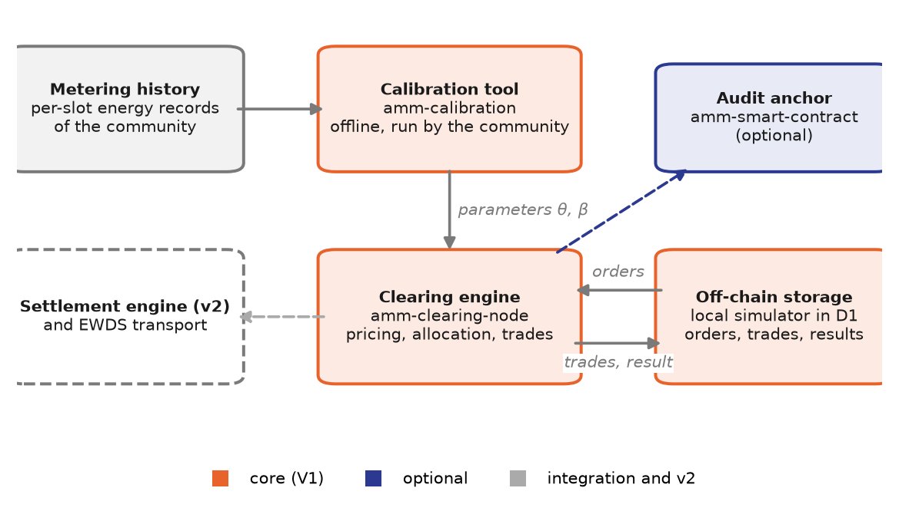

# Architecture

## Components

AMMBA consists of four independently deployable components. Each has its own
build, tests and onboarding guide (`AGENTS.md`) in its directory.



| Component         | Path                 | Technology                                | Role                                                                                                                                                  |
| ----------------- | -------------------- | ----------------------------------------- | ----------------------------------------------------------------------------------------------------------------------------------------------------- |
| Clearing engine   | `amm-clearing-node`  | Python 3.11+, FastAPI                     | Clears a market slot: reads the orders, computes price and allocation, generates the trades and the clearing result. Optional self-trigger scheduler. |
| Calibration tool  | `amm-calibration`    | Python 3.11+, standard library and PyYAML | Offline job that calibrates the pricing parameters from metering history and outputs a configuration snippet.                                         |
| Settlement engine | `amm-execution-node` | Python 3.11+, web3.py                     | Version 2: turns AMM trades into on-chain matches and submits them for settlement. Also holds the penalty formulas.                                   |
| Audit anchor      | `amm-smart-contract` | Solidity 0.8.24, Hardhat                  | Optional: records clearing results on-chain. Its role next to the GSY DEX settlement layer is under review.                                           |

The clearing engine reaches market data through one of two transports with an
identical interface: direct REST access to an off-chain store (the default, also
used with the bundled simulator) or the Energy Web Digital Spine (EWDS) gateway.
See [the clearing engine](clearing-engine.md#transports) and the
[EWDS transport](../integration/ewds.md).

## Design principles

- **Separation of algorithm and input/output.** Pricing, allocation and
  preference rules are pure functions without side effects; only the
  orchestration of a clearing run accesses external systems. The algorithmic
  core can therefore be tested with concrete numbers and reused independently.
- **Determinism and reproducibility.** All identifiers of generated objects are
  derived deterministically from their inputs. Re-running the clearing of a slot
  yields identical results, and an idempotency check prevents a slot from being
  cleared twice.
- **Validation at the boundary.** Incoming orders and outgoing trades and
  clearing results are validated against the data schemas of the INTELLIGENT
  ontology with a small dependency-free validator, so format deviations are
  detected immediately.
- **Explicit units.** The model operates in ct/kWh, in which tariff bands are
  usually expressed; the exchange interface uses EUR/kWh as defined by the
  ontology. The conversion happens in exactly one place.
- **Few dependencies and an open licence.** The calibration tool needs only the
  Python standard library and a YAML parser. All components are published under
  GPL-3.0-or-later.

## Repository layout

```text
ammba_uoc/
├── amm-clearing-node/       # clearing engine (FastAPI)
│   ├── src/                 # clearing.py, sigmoid.py, preferences.py, adapters.py, ...
│   ├── schemas/intelligent/ # vendored INTELLIGENT ontology schemas (the wire contract)
│   ├── sim/                 # schema-validating off-chain store and gateway simulator
│   └── tests/
├── amm-calibration/         # calibration tool (offline job)
├── amm-execution-node/      # settlement engine (v2) and penalty formulas
├── amm-smart-contract/      # optional audit-anchor contract (Hardhat)
├── docs/                    # this documentation (MkDocs)
├── docker-compose.yml       # clearing engine + simulator (profile "dev")
└── mkdocs.yml
```

## Where to start reading the code

| Task                                       | Start here                                                                |
| ------------------------------------------ | ------------------------------------------------------------------------- |
| Change the clearing pipeline               | `amm-clearing-node/src/clearing.py`                                       |
| Change the price function                  | `amm-clearing-node/src/sigmoid.py` (and its copy in `amm-execution-node`) |
| Change the wire format                     | `amm-clearing-node/src/adapters.py` and `schemas/intelligent/`            |
| Change preferences or differential pricing | `amm-clearing-node/src/preferences.py`                                    |
| Change the calibration objective           | `amm-calibration/src/optimizer.py`                                        |
| Change settlement                          | `amm-execution-node/src/engine.py` and `match_builder.py`                 |

Each component's `AGENTS.md` describes its conventions and typical change
recipes in more detail.
