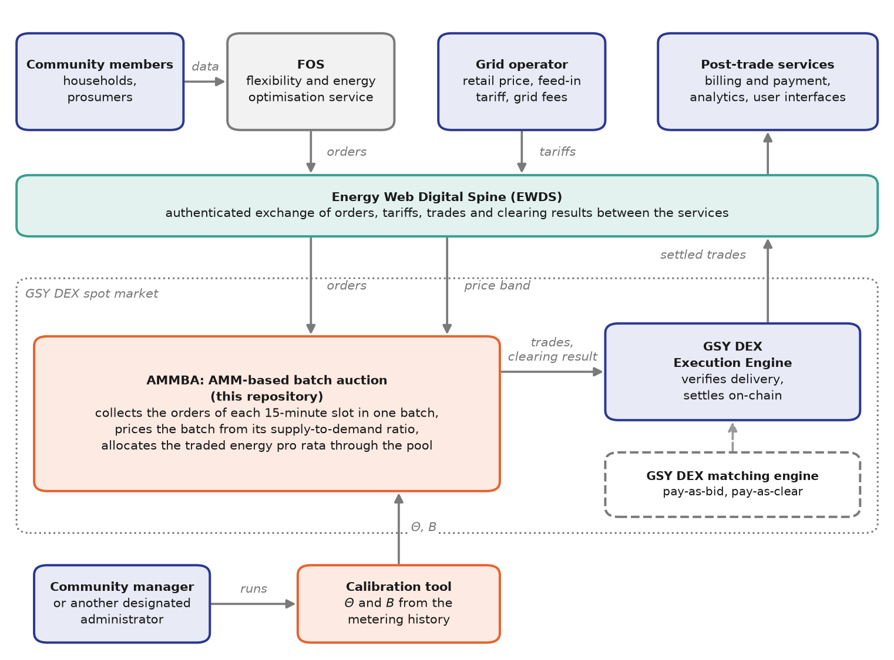

# Integration with the GSY DEX

AMMBA is integrated into the INTELLIGENT platform as an alternative matching
mechanism of the GSY Decentralised Energy Exchange (GSY DEX), alongside the
exchange's order-book mechanisms.

_Simplified view: the Energy Web Digital Spine (EWDS) is the interface between
the services. Orders and tariffs reach AMMBA through it; AMMBA hands its trades
and clearing results to the GSY DEX execution engine for on-chain settlement,
and settled trades flow back to the post-trade services. The calibration tool,
run by the community's administrator, supplies $\Theta$ and $B$. The community
selects the matching mechanism per market._

## Principles

- **Interchangeability through the ontology.** AMMBA consumes and produces the
  same ontology objects as the other mechanisms: orders as input, trades and
  clearing results as output. A community can therefore change its mechanism
  without changing the data that participants submit. See the
  [data model](data-model.md).
- **Data exchange through EWDS.** AMMBA reads market data through the EWDS
  gateway of the GSY DEX. See the [EWDS transport](ewds.md).
- **Settlement through the GSY DEX.** AMMBA's matches are settled through the
  exchange's on-chain settlement layer, so all mechanisms share one verifiable
  settlement path. See the
  [settlement engine](../implementation/settlement-engine.md).

## Current support

The table describes the integration with the GSY DEX at version `GSYDEXv2`
`f0ea6c8` (2026-10-30).

| Capability                                                                              | Status                                                                                                                                                                |
| --------------------------------------------------------------------------------------- | --------------------------------------------------------------------------------------------------------------------------------------------------------------------- |
| Orders in, trades and clearing results out in the ontology                              | Supported                                                                                                                                                             |
| Reading orders and markets for clearing, and measurements for calibration, through EWDS | Supported                                                                                                                                                             |
| Discovery of closed AMM markets and self-triggered clearing                             | Supported                                                                                                                                                             |
| Writing trades and clearing results to the off-chain storage through EWDS               | Not available: the storage records trades and clearing results from settlement events only ([#84][i84])                                                               |
| AMM markets and order-book markets side by side in one GSY DEX deployment               | Not available: the market orchestrator assigns one matching algorithm to all markets, and the GSY DEX matching engine matches the orders of every market ([#83][i83]) |
| Energy-type differential pricing                                                        | Implemented, no effect: the ontology has no grey energy type ([preferences](../model/extensions.md#energy-type-differential-pricing))                                 |
| Settlement of AMM trades through the GSY DEX settlement layer                           | In development ([known limitations](../implementation/settlement-engine.md#known-limitations))                                                                        |

[i83]: https://github.com/INTELLIGENT-UoC/ammba_uoc/issues/83
[i84]: https://github.com/INTELLIGENT-UoC/ammba_uoc/issues/84

## Verification on a GSY DEX deployment

The supported read and clearing path was verified on 2026-11-03 against a
staging deployment of the GSY DEX at the version above, through its EWDS
gateway. The staging environment receives no live orders or metering data, so
it was seeded with the [staging test data set](../implementation/testing.md#testing-against-a-deployment)
for that day. The scheduler discovered the 47 AMM markets that had closed,
read their orders and cleared every market: 273 trades and 47 clearing results,
all valid against the ontology and identical to a replay of the same data in
the local simulator. The measurement fetch returned the seeded metering
records of the previous two days, and the calibration tool produced a parameter
set from them. A captured order response of the off-chain storage is kept as a
regression fixture of the clearing node's tests.
