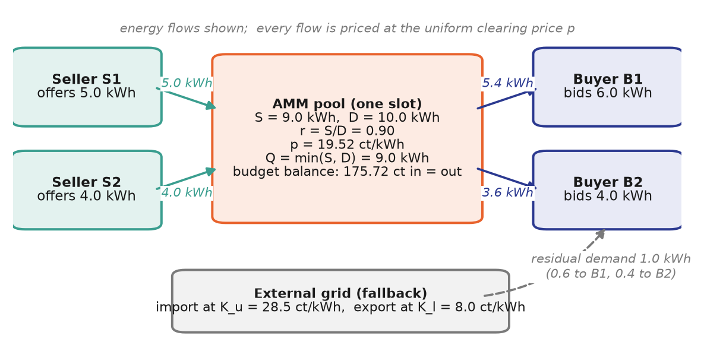

# Allocation and gains from trade

## Allocation

The traded volume of slot $t$ is the largest volume that can be matched
locally:

$$
Q_t = \min(S_t, D_t) \tag{2}
$$

The short side of the market is served completely, and the long side is
rationed in proportion to the submitted quantities:

$$
x_{i,t} = s_{i,t} \frac{Q_t}{S_t}, \qquad y_{j,t} = d_{j,t} \frac{Q_t}{D_t} \tag{3}
$$

Here $x_{i,t}$ is the energy sold by seller $i$ and $y_{j,t}$ the energy bought
by buyer $j$. Residual demand $d_{j,t} - y_{j,t}$ is supplied by the retail
supplier at $K_{u,t}$, and residual supply $s_{i,t} - x_{i,t}$ is exported at
$K_{l,t}$, outside the AMMBA market. If one side of the market is empty, no
local trade takes place in the slot.

## Properties

- **Budget balance.** Buyers pay $p_t \sum_j y_{j,t} = p_t Q_t$ and sellers
  receive $p_t \sum_i x_{i,t} = p_t Q_t$. The pool neither accumulates nor
  requires money, so neither a subsidy nor an operator margin is needed.
- **Individual rationality.** Since $K_{l,t} \le p_t \le K_{u,t}$, every buyer
  pays at most the retail price and every seller receives at least the feed-in
  remuneration for each traded kWh. Taking part in the market is never worse
  than using the grid alone.
- **Maximal local matching.** Given the submitted quantities, no allocation can
  match more energy locally than $Q_t$.

## Gains from trade

Relative to a situation in which all participants use only the grid, local
trade creates the gain

$$
G_t = Q_t \, (K_{u,t} - K_{l,t}) \tag{4}
$$

which does not depend on the price. The price only determines how this gain is
divided: buyers save $Q_t (K_{u,t} - p_t)$ and sellers earn
$Q_t (p_t - K_{l,t})$. Substituting Eq. (1) yields an exact interpretation of the
pricing function:

$$
\frac{K_{u,t} - p_t}{K_{u,t} - K_{l,t}} = \sigma\big(\beta (r_t - \theta)\big),
\qquad \sigma(z) = \frac{1}{1 + e^{-z}} \tag{5}
$$

The buyers' share of the gains from local trade is the logistic function of the
scaled deviation of the ratio from $\theta$, and the sellers receive the
complementary share. When supply is scarce ($r_t < \theta$), sellers receive
more than half of the gains; when supply is abundant ($r_t > \theta$), buyers
do. Within a slot, the pricing function is therefore a rule for sharing the
gains from local trade. Across slots, the resulting price variation signals
local scarcity and rewards shifting flexible consumption to periods of
abundant local generation.

## Worked example

Two buyers and two sellers trade in one slot, with the default parameters
$\theta = 1$, $\beta = 2.5$, $K_u = 28.5$ ct/kWh and $K_l = 8.0$ ct/kWh. Supply
is $S = 9$ kWh and demand $D = 10$ kWh, so $r = 0.9$ and Eq. (1) gives
$p = 19.52$ ct/kWh, slightly above the midpoint of 18.25 ct/kWh because supply
is the short side. Sellers are served in full and buyers receive 90% of their
bids.

| Participant |       Order (kWh) | Allocated (kWh) | Paid (+) / received (−) (ct) | Residual via grid (kWh) | Gain against grid (ct) |
| ----------- | ----------------: | --------------: | ---------------------------: | ----------------------: | ---------------------: |
| Buyer B1    |               6.0 |             5.4 |                      +105.43 |            0.6 imported |                  48.47 |
| Buyer B2    |               4.0 |             3.6 |                       +70.29 |            0.4 imported |                  32.31 |
| Seller S1   |               5.0 |             5.0 |                       −97.62 |                     0.0 |                  57.62 |
| Seller S2   |               4.0 |             4.0 |                       −78.10 |                     0.0 |                  46.10 |
| **Total**   | S = 9.0, D = 10.0 |         Q = 9.0 |    **0.00** (budget balance) |                     1.0 |             **184.50** |

The gains from local trade of 184.50 ct are split 43.8% to the buyers and
56.2% to the sellers, exactly as Eq. (5) predicts with
$\sigma(2.5 \cdot (0.9 - 1)) = 0.438$.

The clearing engine reproduces this example exactly: with these four orders it
computes a clearing price of 19.5246 ct/kWh and the allocation above.

## Representation as trades

On the exchange, every pool allocation is represented by two bilateral trades:
one between the buyer and the pool and one between the pool and the seller,
both at the clearing price. The pool appears as a configured actor of the
community. Mutual preferred partners trade directly with each other instead;
see [preferences](extensions.md#preferred-trading-partners) and the
[data model](../integration/data-model.md).
