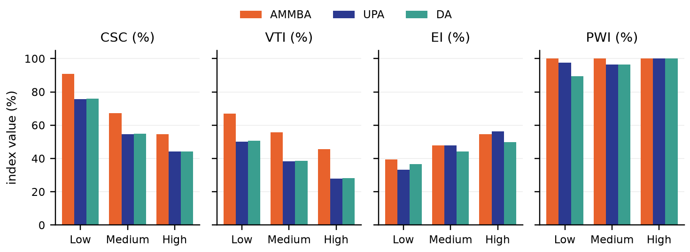

# Evaluation

Saber et al. (2026) evaluate AMMBA in a simulation study that compares it with
two order-book mechanisms on the same data. This page summarises the setup and
the main results. The code and data of the study are available in the
[AMMBA simulation repository](https://github.com/INTELLIGENT-UoC/ammba_simulation).

## Setup

**Data.** The study builds on a public dataset of an energy community with 250
households (Faia et al., 2023), which contains consumption profiles derived
from public data from the United Kingdom and France, PV generation profiles
synthesised from measured data, home batteries and electric vehicles, and
prices based on Portuguese tariffs. From it, a synthetic community of 1,000
households was generated by statistically scaling and diversifying the
profiles. Four days are used: three for calibrating the pricing parameters and
one, not used in the calibration, for the evaluation. The retail price varies
over the day, the feed-in tariff is fixed, and only slots with local surplus
are traded.

**Scenarios.** Three scenarios differ in their share of prosumers. Total demand
is identical; the local surplus grows with the number of prosumers. Demand is
counted in the slots with local surplus.

| Scenario | Prosumers | Consumers | Prosumer share | Total demand (kWh) | Total surplus (kWh) |
| -------- | --------: | --------: | -------------: | -----------------: | ------------------: |
| Low      |       291 |       709 |            29% |             32,483 |               7,105 |
| Medium   |       565 |       435 |            56% |             32,483 |              13,400 |
| High     |       856 |       144 |            86% |             32,483 |              20,118 |

**Benchmarks.**

- The **double auction (DA)** is a continuous limit-order-book market with
  pay-as-bid pricing. Orders arrive in random sequence; an incoming order is
  executed against resting orders at compatible prices, with the transaction
  price set by the incoming order.
- The **uniform-price auction (UPA)** ranks bids in descending and offers in
  ascending order of price and clears at the intersection of the resulting
  curves, at one price for all accepted orders.

Bid prices are drawn around two thirds of the retail price, and offer prices
depend on the retail price, the feed-in tariff and the seller's current surplus
relative to its peak. The same bid prices determine the buyers' funding in the
AMMBA simulation, so all three mechanisms face the same willingness to pay. In
their price formation, DA and UPA correspond to the pay-as-bid and pay-as-clear
mechanisms described in [market design](../background/market-design.md).

**Indicators.** Besides supplier profit, consumer utility and their sum, the
welfare, the study uses four indices (Zhou et al., 2018):

- **Community self-consumption (CSC):** the share of the community's surplus
  that is consumed within the community.
- **Value tapping index (VTI):** the share of the theoretically achievable
  savings of local sharing that a mechanism realises, relative to no local
  trading.
- **Participation willingness index (PWI):** the share of participants whose
  energy costs decrease.
- **Equality index (EI):** one minus a normalised Gini coefficient of the
  participants' incomes.

## Calibrated parameters

Scenarios with more local generation require a higher midpoint and a lower
steepness, and lowering $\alpha$ reduces both, which yields flatter curves and
more stable prices. The evaluation uses $\alpha = 0.5$.

The study evaluates the publication's formulation, in which buyers fund their
purchases and the ratio is offered energy over funds (kWh/EUR). The values
below are on that scale and do not carry over to the energy ratio $E_t / D_t$
of this software; calibrate a community's parameters with the
[calibration tool](../implementation/calibration-tool.md).

| Scenario | $\Theta$ ($\alpha = 0.5$) | $B$ ($\alpha = 0.5$) | $\Theta$ ($\alpha = 0.4$) | $B$ ($\alpha = 0.4$) |
| -------- | ------------------------: | -------------------: | ------------------------: | -------------------: |
| Low      |                      0.25 |                 2.51 |                      0.16 |                 1.74 |
| Medium   |                      0.39 |                 1.24 |                      0.29 |                 0.90 |
| High     |                      0.61 |                 0.84 |                      0.45 |                 0.61 |

## Results

Values on the evaluation day, given as AMMBA / UPA / DA:

| Indicator              | Low                   | Medium                | High                    |
| ---------------------- | --------------------- | --------------------- | ----------------------- |
| Supplier profit (EUR)  | 278.3 / 554.9 / 292.8 | 445.6 / 694.8 / 362.9 | 608.9 / 837.7 / 437.7   |
| Consumer utility (EUR) | 689.8 / 249.7 / 516.6 | 916.8 / 429.1 / 764.7 | 1,058.5 / 534.2 / 939.2 |
| Welfare (EUR)          | 968 / 805 / 809       | 1,362 / 1,124 / 1,127 | 1,667 / 1,372 / 1,377   |
| CSC (%)                | 90.9 / 75.6 / 76.1    | 67.2 / 54.7 / 55.0    | 54.6 / 44.2 / 44.3      |
| VTI (%)                | 67.0 / 50.1 / 50.6    | 55.7 / 38.2 / 38.5    | 45.7 / 28.0 / 28.3      |
| EI (%)                 | 39.4 / 33.4 / 36.7    | 47.8 / 47.9 / 44.1    | 54.7 / 56.4 / 49.8      |
| PWI (%)                | 100 / 97.6 / 89.4     | 100 / 96.5 / 96.5     | 100 / 100 / 100         |

- **Self-consumption.** AMMBA achieves the highest CSC in every scenario, 10 to
  15 percentage points above DA and UPA, a relative increase of about 20%. The
  pool distributes all available local supply to the buyers, whereas in DA and
  UPA offers priced above the buyers' bids remain unsold.
- **Welfare.** Welfare under AMMBA is about 20% higher than under DA and UPA in
  every scenario, and the VTI is about 17 percentage points higher.
- **Balance between the two sides.** AMMBA yields the highest consumer utility
  in every scenario. UPA yields the highest supplier profit but the lowest
  consumer utility, because its price is set by the marginal accepted offer.
- **Participation and equality.** Under AMMBA, every participant benefits
  compared with no local trading (PWI of 100%) in all scenarios. The EI of
  AMMBA exceeds that of DA in all scenarios and is comparable to that of UPA.
- **Price stability.** The AMMBA price follows the supply-to-demand ratio
  smoothly, whereas individual DA prices vary widely and can reach the limits
  of the band.
- **Design rather than matching.** DA and UPA reach almost identical CSC, VTI
  and welfare, which indicates that the advantage of AMMBA stems from its
  pool-based batch design rather than from details of order matching.
- **Robustness.** With zero-mean Gaussian forecast errors of up to 20% on the
  reported demand and supply, CSC, VTI and welfare of AMMBA change by less than
  0.2% in the high scenario.

The study assumes perfect foresight within each settlement cycle, which the
robustness analysis relaxes, and does not model participants adapting their
strategies over time.
