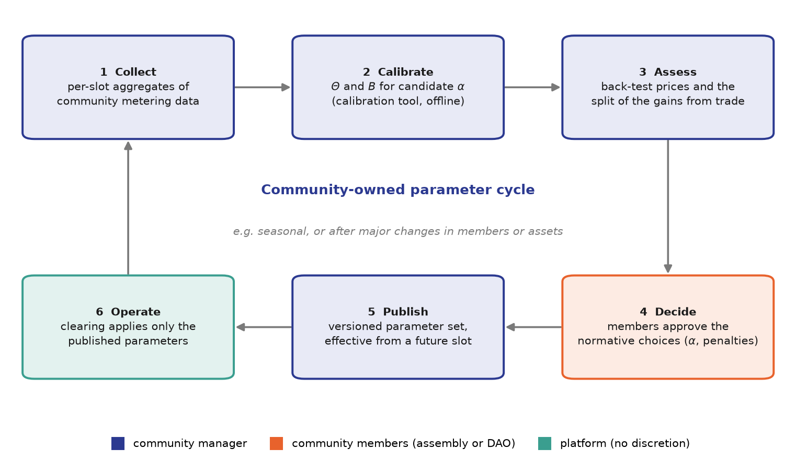

# Parameter governance

The AMMBA parameters decide, in every slot, how the gains from local trade are
divided between the community's buyers and sellers (see
[gains from trade](allocation.md#gains-from-trade)). Choosing them is therefore
not only a technical task but a distributive decision, and it belongs to the
community. It is also a precondition for the community to own its trading
tools in practice. AMMBA does not prescribe a governance system: each community
uses the governance system of its choice. This page describes the roles and
the process that such a system fills.

## Parameter classes and responsibilities

| Parameter                              | Meaning                                                     | Nature of the decision          | Responsibility                                                                | Update cycle                                                             |
| -------------------------------------- | ----------------------------------------------------------- | ------------------------------- | ----------------------------------------------------------------------------- | ------------------------------------------------------------------------ |
| $K_{\mathrm{up},t}$, $K_{\mathrm{lo}}$ | Price band: retail price and feed-in tariff                 | Given by tariffs and regulation | Administrator, from the applicable supply contract and feed-in scheme         | When tariffs change                                                      |
| $\Theta$, $B$                          | Midpoint and steepness of the pricing function              | Technical and data-driven       | Administrator, using the calibration tool on the community's metering history | Periodically, for example monthly or seasonally, and after major changes |
| $\alpha$                               | Weight between balanced sharing and strong scarcity signals | Normative                       | Community members, through their governance system                            | Rarely, for example annually                                             |
| $\gamma$, $\eta_t$                     | Penalty level and tolerance for deviations                  | Normative, informed by data     | Members decide; the administrator proposes values                             | Annually, or when deviations are observed                                |
| Differential pricing rates             | Green subsidy, grey levy and levy cap                       | Normative                       | Community members                                                             | On demand                                                                |

## Roles

- **Administrator.** The person or organisation that the community designates
  for this role, for example the community manager, maintains the price band,
  runs the calibration, prepares parameter proposals together with an impact
  assessment, and publishes the approved parameter sets.
- **Community members.** The members decide the normative parameters through
  the community's governance system, whatever form it takes. They receive
  regular transparency reports and can request a recalibration.
- **Grid operator and regulator.** They own no AMMBA parameters but define the
  frame in which the parameters are set, in particular the tariff components
  that enter the band and the rules for energy sharing under the national
  implementation of the EU provisions on renewable and citizen energy
  communities (Directive (EU) 2018/2001 and Directive (EU) 2019/944).
- **Platform operator.** The operator of the exchange applies the published
  parameters and has no discretion over their values.

## Process

1. **Collect.** The administrator retrieves the community's metering history
   from the off-chain storage over the EWDS and aggregates it per slot; see
   the [calibration tool](../implementation/calibration-tool.md#input-data).
2. **Calibrate.** Candidate parameters are calibrated for one or more values
   of $\alpha$.
3. **Assess.** The effect of a candidate set is assessed by recomputing past
   slots, which shows the resulting prices and the split of the gains from
   trade compared with the parameters in force.
4. **Decide.** Normative changes are approved by the members. Routine
   recalibrations within an approved $\alpha$ can be adopted by the
   administrator.
5. **Publish.** The approved set is published with a version number and the
   slot from which it applies.
6. **Operate.** The market is cleared with the published parameters until the
   next cycle.

## Principles

- **Prospective effect.** Parameter changes apply only to future slots. Slots
  that have been cleared are never repriced.
- **Transparency and verifiability.** Parameter sets are versioned and
  published. Because the price depends only on aggregate quantities and the
  parameters, any member can verify every clearing price for the parameter set
  in force. Today the clearing engine reads the parameters from its
  configuration; publishing them through the exchange, so that clearing
  results can be traced to the parameter set that produced them, is planned
  ([#35](https://github.com/INTELLIGENT-UoC/ammba_uoc/issues/35)).
- **Data minimisation.** The optimisation needs only per-slot aggregates of
  supply and demand. The measurement records retrieved for it stay with the
  administrator as a snapshot file and are reduced to aggregates before use, in
  line with the data minimisation principle of the GDPR.
- **Community ownership.** The calibration tool is open source and runs
  offline on the retrieved snapshot, so the community can execute the full
  cycle itself.

## Explaining α to the community

The weight $\alpha$ is the parameter that most directly expresses community
values, and it should be explained in non-technical terms:

- A **low** $\alpha$ keeps prices close to the middle of the band in most
  slots. Buyers and sellers share the gains from local trade almost evenly,
  but price differences between scarce and abundant periods are small.
- A **high** $\alpha$ stretches the price curve towards the retail price in
  scarce periods and towards the feed-in tariff in abundant ones. The
  split within a slot becomes more uneven, but the price sends stronger
  signals to shift consumption into periods of local surplus.

In the [evaluation](evaluation.md#calibrated-parameters), lowering $\alpha$
from 0.5 to 0.4 reduced the calibrated steepness in every scenario. The
evaluation uses $\alpha = 0.5$, which is also the default of the calibration
tool. Running the tool for several values of $\alpha$ shows the community how
the calibrated parameters change with this choice.
