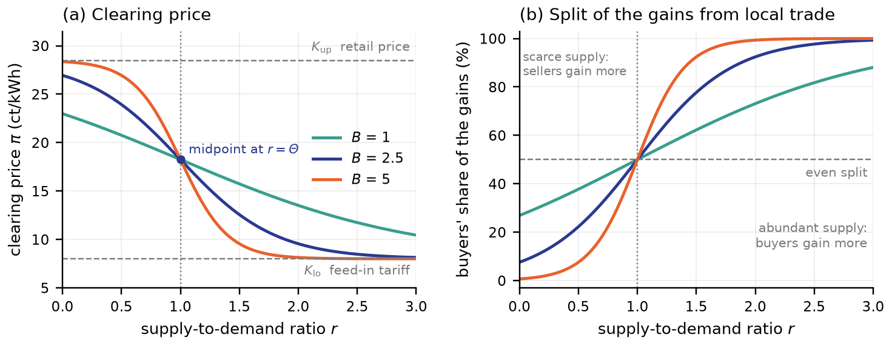

# Pricing function

## Market setting

Buyers $i$ and sellers $j$ trade in market cycles $t$, one per delivery slot.
Every participant has an outside option: buying from its supplier at the
retail price $K_{\mathrm{up},t}$, or exporting to the grid at the feed-in
tariff $K_{\mathrm{lo}}$, with $K_{\mathrm{up},t} > K_{\mathrm{lo}}$. The retail
price may vary by slot, for example under time-of-use tariffs. The difference
$K_{\mathrm{up},t} - K_{\mathrm{lo}}$ is the gain per kWh that local trade
creates relative to the grid alternatives.

The AMMBA pool is a virtual counterparty. In each slot it buys all allocated
energy from the sellers and sells it to the buyers at a single clearing price
$\pi_t$. It holds no inventory and makes no profit.

## The pricing function

The clearing price is a sigmoid function $f$ of the supply-to-demand ratio
$r_t$ of the batch:

$$
\pi_t = f(r_t) = K_{\mathrm{up},t} - \frac{K_{\mathrm{up},t} - K_{\mathrm{lo}}}{1 + e^{-B (r_t - \Theta)}} \tag{1}
$$

How demand enters the ratio depends on the form of the mechanism. With
$E_t = \sum_j E_{t,j}$ the energy offered by the sellers:

- In the **token-based formulation**, buyers deposit money $M_{t,i}$, and the
  ratio is the energy-to-money ratio $r_t = E_t / M_t$ with
  $M_t = \sum_i M_{t,i}$.
- In the **order-based form** used by the clearing engine, buyers state their
  demand $D_{t,i}$ in kWh, and the ratio is $r_t = E_t / D_t$ with
  $D_t = \sum_i D_{t,i}$.

The midpoint $\Theta$ and the steepness $B \ge 0$ set the shape of the curve.
Both are expressed on the scale of the chosen ratio and are calibrated for it.
The figure shows the function for the default band of the implementation,
$K_{\mathrm{up}} = 28.5$ ct/kWh and $K_{\mathrm{lo}} = 8.0$ ct/kWh, with
$\Theta = 1$ and three values of $B$.

_Panel (a): the clearing price as a function of the supply-to-demand ratio.
Panel (b): the buyers' share of the gains from local trade, explained in
[allocation and gains from trade](allocation.md#gains-from-trade)._

## Properties

The following properties follow directly from Eq. (1).

- **Bounded.** For every ratio, $K_{\mathrm{lo}} < \pi_t < K_{\mathrm{up},t}$:
  the price never leaves the band of the outside options. The implementation
  additionally clamps the result to the closed band to exclude numerical
  artefacts.
- **Monotone.** For $B > 0$ the price strictly decreases in $r_t$: relatively
  more local supply means a lower price, relatively more demand a higher one.
  For $B = 0$ the price is constant at the midpoint of the band.
- **Anchored at $\Theta$.** At $r_t = \Theta$ the price equals the midpoint
  $(K_{\mathrm{up},t} + K_{\mathrm{lo}})/2$ of the band. In the order-based form
  with $\Theta = 1$, a balanced slot with $E_t = D_t$ is priced at the midpoint.
- **Tunable sensitivity.** The slope at the midpoint is
  $-B (K_{\mathrm{up},t} - K_{\mathrm{lo}})/4$, so $B$ scales how strongly the
  price reacts to scarcity or abundance.
- **Verifiable.** The price depends only on two aggregate quantities and the
  published parameters. Any participant can recompute it without access to
  individual orders.

## Interpretation as an automated market maker

In AMM terms, Eq. (1) plays the role of the bonding curve: the
supply-to-demand ratio of the batch takes the place of the ratio of pool
reserves in a constant-function market maker. Unlike such market makers, the
AMMBA pool holds no inventory. The grid absorbs any imbalance at the two ends
of the band; see [market design](../background/market-design.md).

## Implementation notes

The function is implemented in `amm-clearing-node/src/sigmoid.py`, which
evaluates it on the energy ratio $E_t / D_t$. The configuration names the
parameters `k_upper_ct_per_kwh` ($K_{\mathrm{up}}$), `k_lower_ct_per_kwh`
($K_{\mathrm{lo}}$), `theta` ($\Theta$) and `steepness` ($B$). The exponent is
limited to $[-500, 500]$ to prevent overflow, and the result is clamped to the
band. A copy in `amm-execution-node/src/sigmoid.py` serves counterfactual
pricing for the penalty mechanism and must be kept identical. The calibration
tool uses the unclamped function; see
[calibration](calibration.md#solution-method).
